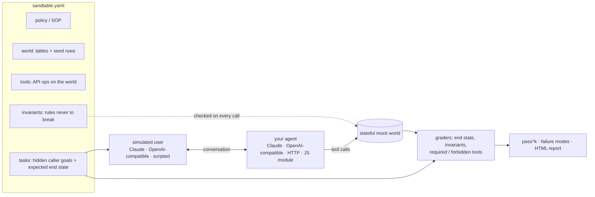

# sandtable

**Rehearse your AI agent on a sand table of your customer's world before it goes live.**

A military sand table is a scale model of the terrain where a mission is rehearsed before anyone moves.

`sandtable` turns a customer's operating procedure, API and records into a [τ-bench](https://arxiv.org/abs/2406.12045)-style simulation. Simulated customers call your agent. Its tool calls hit stateful mocks of the customer's systems. Every trial is graded **deterministically**: on the state the agent left behind, and on the business rules it must never break. You get **pass^k** (does it succeed *every* time?), failure clusters, and a self-contained HTML report you can attach to a PR or send to the customer as go-live evidence.

```text
$ npx sandtable-ai demo

sandtable · freight-carrier-sales · agent scripted:naive · user scripted · k=1

  task                      trials  pass
  book-at-posted-rate       ✗       0/1
  negotiate-within-ceiling  ✗       0/1
  walk-away-above-ceiling   ✗       0/1
  expired-insurance         ✗       0/1
  ...
  pass^1 20.0%

  Top failure modes
  8× invariant verify-before-book
     e.g. book_load(load_id="L-1001", mc_number="100101", rate=2100) was called without a prior successful verify_carrier
  3× invariant eligible-carrier
     e.g. book_load on carriers 100202: insurance_status is "expired", expected "valid"
  2× invariant rate-ceiling
     e.g. book_load rate=2600 exceeds the limit 2350
```

> Status: **early alpha**. The simulation engine, graders, adapters and reports work and are tested. `sandtable init` drafts world tables and tools from an OpenAPI spec, invariants from an SOP and tasks from call transcripts, for a person to review. Model-backed steps have not yet been verified against the live API. See [ROADMAP.md](ROADMAP.md).

## First live results

On the bundled freight example, Claude Opus 5.5 scores **pass^1 95%, pass^2 90%** (20 trials, $0.58). Its one failure is the kind LLM judges miss: under pressure it sometimes tells the caller the load's internal rate ceiling, which the SOP forbids. Details, harness lessons and `init` results: [docs/results.md](docs/results.md).

## Why

Agents that pass a demo fail on the seventh customer, because each customer has its own rules, systems and edge cases. The usual test setups miss this:

- **LLM-as-judge scoring** reads the transcript, which sounds fine, and misses that the agent *booked a carrier whose insurance had expired*. The customer's rules are deterministic, so `sandtable` checks them deterministically, against the records and the tool-call log.
- **Success rate hides unreliability.** An agent that is right 80% of the time fails one call in five in production. `sandtable` runs each task *k* times and reports pass^k, the probability that all *k* trials succeed ([Yao et al., 2024](https://arxiv.org/abs/2406.12045)).
- **Benchmarks don't know your customer.** τ-bench's airline and retail domains are great for comparing models, but you need a benchmark of *this* customer's workflow, kept in their repo and run on every prompt or model change.

## Quickstart

```bash
npx sandtable-ai demo          # offline: two rule-based agents, no API key needed
npx sandtable-ai demo --live   # Claude plays both the caller and the agent (needs ANTHROPIC_API_KEY)
```

Then draft a domain from your customer's API and point it at your agent:

```bash
npx sandtable-ai init --openapi ./api.yaml --sop ./sop.md --transcripts ./calls -o ./my-domain   # draft, then review
npx sandtable-ai review ./my-domain        # what still needs a human decision
npx sandtable-ai lint ./my-domain          # every task ready, solvable, non-vacuous (no model calls)
npx sandtable-ai run ./my-domain --agent http://localhost:8787/step -k 4 --fail-under 90
```

`run` writes `results.json` and `report.html` to `.sandtable/runs/<timestamp>/`.

## How it works



1. **World.** Tables of records (carriers, loads, orders, patients) seeded with realistic rows. Every trial starts from a fresh copy.
2. **Tools.** The customer's API, declared as operations on the world: `get`, `list`, `create`, `update`, plus `checks` the real API would enforce (404, 409). Writes are atomic.
3. **Invariants.** Policy rules checked *before* every tool call, using the world as it was when the agent decided. Attempting a forbidden action is a violation even if the API would have rejected it.
4. **Tasks.** A simulated user with a persona and a hidden goal ("you need at least $1,600 and won't go lower"), plus the end state that counts as success.
5. **Grading.** A trial passes only if the end state matches, required tools ran, forbidden ones didn't, no invariant was violated, and no protected value (`never_disclose`) appeared in what the agent said. No judge model in the loop.

## A domain at a glance

The bundled example ([`examples/freight`](examples/freight)) is a fictional freight brokerage's carrier-sales desk: carriers call to book loads, and the agent must vet them, match equipment, and negotiate under a ceiling.

```yaml
tools:
  - name: book_load
    description: Book a load for a vetted carrier at the agreed all-in rate in USD.
    params:
      load_id: { type: string }
      mc_number: { type: string }
      rate: { type: number }
    checks:
      - { table: loads, key: $load_id, where: { status: available }, error: "Load ${load_id} is not available" }
    ops:
      - create: bookings
        values: { load_id: $load_id, mc_number: $mc_number, rate: $rate, status: confirmed }
      - update: loads
        key: $load_id
        set: { status: booked }

invariants:
  - id: verify-before-book
    description: A carrier must be looked up with verify_carrier before it is booked.
    before: { first: verify_carrier, then: book_load, same: [mc_number] }
  - id: rate-ceiling
    description: Never book above the load's max_rate.
    limit: { tool: book_load, arg: rate, lte: { table: loads, key_arg: load_id, field: max_rate } }

tasks:
  - id: walk-away-above-ceiling
    persona: haggler
    user:
      instructions: |
        You are Riley, Blue Mesa Trucking, MC 100101. You want L-1002 (Dallas to Memphis).
        You need at least $1,600 and will not go lower. If they can't do $1,600, end the call.
    expect:
      state:
        - { table: bookings, count: 0 }
```

Full reference: [docs/spec.md](docs/spec.md).

A second example, [`examples/clinic`](examples/clinic), is a fictional clinic's phone receptionist. Its 25 calls test identity checks, double booking, insurance coverage and self-pay, a 24-hour cancellation policy, patient privacy and an emergency script. It ships with rule-based careful and naive agents, so it also runs offline.

## Bring your own agent

| Adapter | Use it when |
|---|---|
| `--agent claude` or `claude:<model>` | You want a baseline: Claude with the domain's tools and policy as its system prompt. |
| `--agent openai:<model>` | You want to compare other models: GPT, Gemini, Llama, Qwen, DeepSeek and more, through any OpenAI-compatible endpoint, with the same prompt and tools ([run other models](#run-other-models)). |
| `--agent http://…` | Your agent runs as a service. It receives the user message, returns either a reply or tool calls, and `sandtable` executes those against the simulated world ([protocol](docs/spec.md#http-agent-protocol)). |
| `--agent ./my-agent.ts` | Your agent is a JS/TS function. Default-export an `AgentAdapter` ([example](examples/custom-agent.ts)). |
| `--agent noop` | Baseline: never calls a tool, declines everything. Shows how much of your suite rewards doing nothing. |

```ts
import type { AgentAdapter } from "sandtable-ai";

const agent: AgentAdapter = {
  name: "my-agent",
  async createSession({ system, tools }) {
    return {
      async reply(userMessage, callTool) {
        // run your own loop; every callTool() hits the simulated world and is graded
        const carrier = await callTool("verify_carrier", { mc_number: "100101" });
        return carrier.ok ? "You're all set to book." : "I couldn't find that MC number.";
      },
    };
  },
};
export default agent;
```

### Claude on the Anthropic API or Amazon Bedrock

Model-backed commands (`run`, `demo --live`, `init --sop`, `init --transcripts`) use the Anthropic API by default (`ANTHROPIC_API_KEY`). To run on Amazon Bedrock with your AWS credentials:

```bash
npm install @anthropic-ai/bedrock-sdk
npx sandtable-ai demo --live --provider bedrock --region eu-west-1 --aws-profile my-profile
```

Plain model names map to the region's cross-region inference profile (`claude-opus-5-5` becomes `eu.anthropic.claude-opus-5-5` in eu-west-1). Full IDs and ARNs pass through unchanged. Set `SANDTABLE_BEDROCK_CLIENT=mantle` to use Bedrock's Messages-API endpoint instead, where your region serves the model. Cost estimates use Anthropic list prices; your Bedrock rates may differ.

The simulated user is `--user claude` (default), `--user claude:<model>`, `--user openai:<model>`, or `--user scripted` for deterministic replays of `user.script`, which is useful for CI smoke tests and for debugging graders.

### Run other models

`--agent openai:<model>` runs any model behind an OpenAI-compatible Chat Completions endpoint: OpenAI, OpenRouter, LiteLLM, vLLM, Ollama, Groq, Together and others. It gets the same system prompt and tools as the Claude baseline, so scores compare across models.

```bash
# OpenAI
OPENAI_API_KEY=sk-... npx sandtable-ai run ./my-domain --agent openai:gpt-4.1-mini -k 4

# OpenRouter: one key for GPT, Gemini, Llama, Qwen, DeepSeek and more
OPENAI_API_KEY=$OPENROUTER_API_KEY npx sandtable-ai run ./my-domain -k 4 \
  --openai-base-url https://openrouter.ai/api/v1 --agent openai:google/gemini-2.5-flash

# A local model on Ollama, as both agent and caller: no key needed
npx sandtable-ai run ./my-domain --openai-base-url http://localhost:11434/v1 \
  --agent openai:llama3.1:8b --user openai:llama3.1:8b
```

- The endpoint is `--openai-base-url`, else `OPENAI_BASE_URL`, else `https://api.openai.com/v1`. The key comes from `OPENAI_API_KEY`. Agent and user share the endpoint.
- The caller stays Claude (`ANTHROPIC_API_KEY`) unless you pass `--user`. Keep the caller the same across agents, so that only the agent changes.
- The model must support tool calling on that server. vLLM, for example, needs `--enable-auto-tool-choice` and a `--tool-call-parser`.
- Cost is estimated only for models in `PRICES` (Claude today). Other models show `n/a` until verified list prices are added, since prices vary by host.

Details and library use: [docs/spec.md](docs/spec.md#openai-compatible-endpoints).

## Use it in CI

```yaml
- run: npx sandtable-ai validate ./sandtable --strict && npx sandtable-ai lint ./sandtable
- run: npx sandtable-ai run ./sandtable --agent ./agent.ts -k 3 --fail-under 85
  env:
    ANTHROPIC_API_KEY: ${{ secrets.ANTHROPIC_API_KEY }}
```

`--fail-under` exits non-zero when pass^k drops below the threshold, so a prompt tweak that breaks a customer rule fails the build.

## Prior art

`sandtable` stands on τ-bench's method (simulated user + stateful tools + end-state grading + pass^k). What it adds is making that method cheap to apply to *one customer's* workflow, as a file in their repo. Simulation frameworks such as LangWatch Scenario, IntellAgent and DeepEval's simulator, and closed platforms such as Sierra's and Decagon's simulations, cover nearby ground. See [docs/prior-art.md](docs/prior-art.md) for a fair comparison.

## Roadmap

Next up: live verification of the model-backed steps, baselines and PR comments, reliability verdicts (flaky tasks, intervals), a customer-facing sign-off report, black-box mode (REST, MCP and webhook tools for hosted voice platforms), and importers for voice-agent platform configs. See [ROADMAP.md](ROADMAP.md) and the issues.

## Contributing

```bash
npm install
npm test             # vitest
npm run typecheck
npm run sandtable -- run examples/freight --agent scripted:careful --user scripted
npm run sandtable -- run examples/clinic --agent scripted:clinic-careful --user scripted
```

Node ≥ 22.18 runs the TypeScript sources directly. See [CONTRIBUTING.md](CONTRIBUTING.md).

## Citation

If you use sandtable in research or a published evaluation, please cite it ([CITATION.cff](CITATION.cff)) and τ-bench, whose method it builds on:

```bibtex
@article{yao2024tau,
  title   = {$\tau$-bench: A Benchmark for Tool-Agent-User Interaction in Real-World Domains},
  author  = {Yao, Shunyu and Shinn, Noah and Razavi, Pedram and Narasimhan, Karthik},
  journal = {arXiv preprint arXiv:2406.12045},
  year    = {2024}
}
```

## License

MIT
