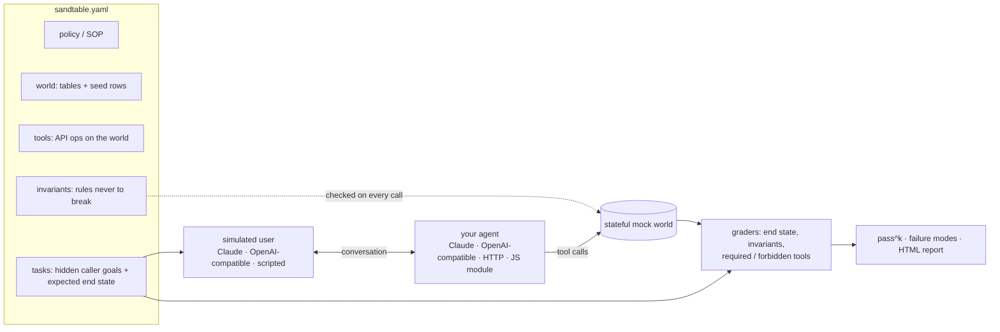

## The parts

1. **World.** Tables of records (carriers, loads, orders, patients) seeded with realistic, fictional rows. Every trial starts from a fresh copy.
2. **Tools.** The customer's API, declared as operations on the world: `get`, `list`, `create`, `update` and `respond`, plus `checks` the real API would enforce (404, 409). Writes are atomic.
3. **Invariants.** Policy rules checked *before* every tool call, using the world as it was when the agent decided. Attempting a forbidden action is a violation even if the API would have rejected it.
4. **Tasks.** A simulated user with a persona and a hidden goal ("you need at least $1,600 and won't go lower"), plus the end state that counts as success.
5. **Grading.** A trial passes only if the end state matches, required tools ran, forbidden ones didn't, no invariant was violated, and no protected value (`never_disclose`) appeared in what the agent said. No judge model is in the loop.

[Domains](/concepts/domain) covers each part in more depth, and the [spec](/reference/spec) lists every field.

## One trial

<Steps>
  <Step title="Fresh world">
    The world is copied from the seed rows. Nothing from an earlier trial carries over.
  </Step>
  <Step title="The user opens">
    The simulated user gets the task's hidden instructions and persona, and speaks first. The agent never sees those instructions. A task can fix the first line with `user.opening`.
  </Step>
  <Step title="The agent works">
    The agent receives the message, the domain's tools as JSON schemas, and a default system prompt built from the domain description and policy (your agent can ignore it and use its own). It may call tools as many times as it wants before replying.
  </Step>
  <Step title="Every tool call is checked, then run">
    Arguments are validated and coerced against the tool's params. Every invariant is evaluated against the world *as it is now*, and violations are recorded. Then the tool's `checks` run, and if they pass, its ops run atomically. The agent gets the result, or a tool error.
  </Step>
  <Step title="The conversation ends">
    The simulated user stops when its goal is met, impossible, or it has been handed off. A closing message with content still gets one last agent turn. A trial that reaches `max_turns` is cut off and graded anyway.
  </Step>
  <Step title="Grading">
    Every agent message is scanned for protected values (`never_disclose`). Then the task's expectations are checked against the final world and the tool-call log. One failed check fails the trial.
  </Step>
</Steps>

## One run

`sandtable run` repeats every task *k* times (`-k`), four trials in parallel by default (`-c`), and reports:

- **pass^k** for every j up to k: the chance that all j trials of a task succeed, averaged over tasks. See [pass^k and reliability](/concepts/pass-k).
- **Failure modes**: failed checks clustered across trials, most frequent first, each with an example.
- **Scores by tag**, so a weak area (negotiation, vetting, handoffs) stands out.
- **Usage**: tokens per model, an estimated cost at list prices (Claude models, plus any model whose prices you pass with `--prices`; others show `n/a`), and p50/p95 agent turn latency.
- **Pending review**: drafted items nobody has accepted yet, which make the run provisional.

It writes `results.json` (every trial's transcript, tool calls, checks and world diff; see [results.json](/reference/results-schema)) and a self-contained `report.html` to `.sandtable/runs/<timestamp>-<domain>/`, or to `--out`.

## What is not modelled

Knowing the edges helps you read a score:

- **Text only.** Conversations are text turns. Audio, latency to first word and interruptions are out of scope for now.
- **One session per task.** There is no memory across calls and no simulated clock ([#38](https://github.com/sandtable-ai/sandtable/issues/38), [#42](https://github.com/sandtable-ai/sandtable/issues/42)).
- **Scalar tool params, no deletes.** Tools take strings, numbers, integers and booleans, and can read, list, create and update rows.
- **The simulated user is a model.** It can drift from its goal or end a call early. Scripted users (`--user scripted`) are deterministic but do not react to what the agent says. Read failing trajectories before blaming the agent.
- **Hard checks only.** Tone, empathy and wording are not graded. Soft, judged scores are planned as a separate score ([#16](https://github.com/sandtable-ai/sandtable/issues/16)).
